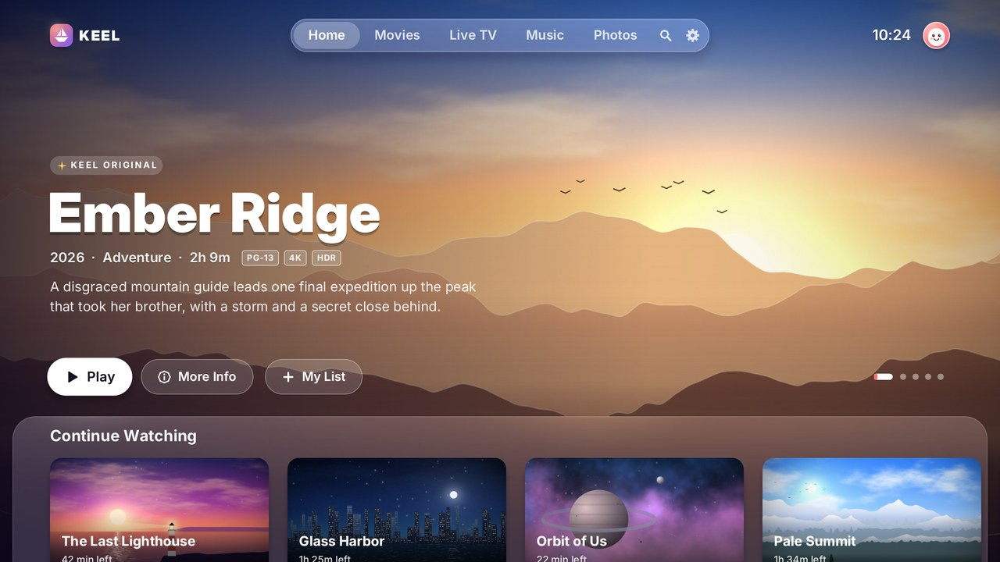
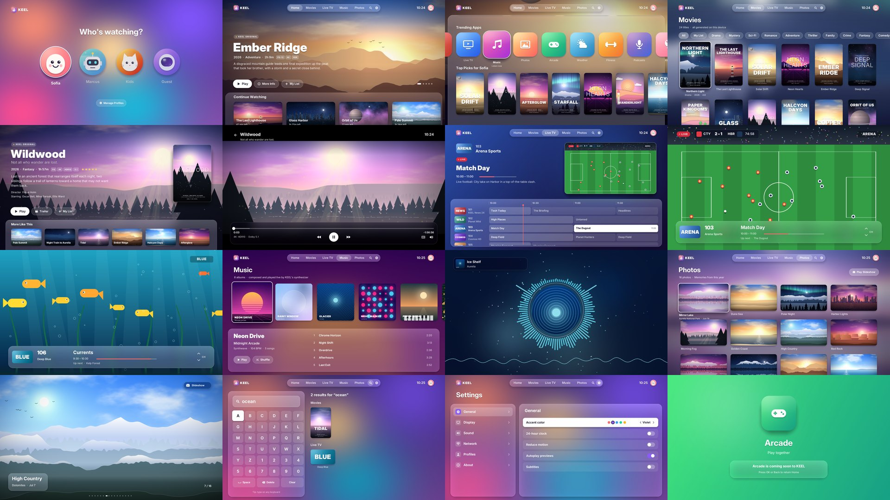

# KEEL OS

A television operating system shell written from scratch in C. It has a boot animation, profiles, a home screen, movies, live TV, music, photos, search and settings. The user interface is drawn by a software renderer written for this project, and every image you see (posters, backdrops, photos, album covers, avatars, app icons, channel broadcasts) is generated in code when the OS starts. There are no stock images, no browser, no Qt/GTK/SDL, no game engine and no Android.





## What's in it

| Area | What it does |
| --- | --- |
| **Boot** | Light particles converge into the KEEL mark, the wordmark resolves letter by letter, and a progress bar tracks artwork generation running in the background. |
| **Who's Watching** | Four profiles with avatars drawn in code, spring focus animation and a Manage Profiles button. |
| **Home** | A full-bleed cinematic hero that rotates through five featured titles with a Ken Burns zoom and crossfades. Below it: Continue Watching with progress bars, Trending Apps and Top Picks, on a frosted-glass sheet that rises as you scroll. |
| **Movies** | 24 posters, each composed procedurally: a landscape scene plus typography, tagline and billing block. Genre filter chips, a My List filter, and a blurred backdrop that follows focus. |
| **Details** | Backdrop, title, tagline, rating badges, star score, synopsis, director and cast, Play / Trailer / My List, and a "More Like This" row on glass. |
| **Player** | The film is rendered live. Four parallax depth layers are panned by a virtual camera that cuts between three shot types, with weather particles, lens flare, letterbox, subtitles, seeking, pause and a glass control bar. |
| **Live TV** | Nine channels, each an animated broadcast: news studio with ticker, live football with scoreboard, nature, space warp, weather map with forecast, underwater, synthwave, kids and cinema. Includes a program guide with a live preview (rounded, layer-composited), a now line, reminders and full-screen viewing with a channel banner. |
| **Music** | Eight albums whose music is synthesized in real time: a step sequencer, oscillators, filters, delay and reverb, each album with its own style. Now Playing has transport controls and a spectrum strip. The **Visualizer** is a beat-reactive radial spectrum driven by an FFT of the audio being heard, with particles and a waveform. |
| **Photos** | 16 generated photographs (lakes with reflections, dunes, aurora, coast, canyon and more), a grid, a full-screen viewer with swipe, and a Ken Burns **slideshow** with crossfades. The slideshow also serves as the screensaver. |
| **Search** | On-screen keyboard (or any physical keyboard) with live results across movies, channels, albums and apps. |
| **Settings** | All working: accent color (recolors the UI), 24-hour clock, reduce motion, subtitles, glass intensity, performance overlay, screensaver timeout, volume, UI sounds, profile switching, and live system info (renderer, frame times, uptime). |

## How it works

```
  input ─► app (screens, focus, springs) ─► display list ─► compositor ─► presenter ─► X11 / framebuffer
                                                 ▲              │ banded, multi-threaded
           procedural art (background jobs) ─────┘              └ frosted glass = barrier + 4×-down blur
```

- **Compositor** (`gfx.c`). Each frame is recorded as a display list. The screen is split into horizontal bands and every render thread draws all commands clipped to the bands it claims. Primitives: anti-aliased rounded rects (distance field, interior spans filled fast), linear gradients, soft shadows, bilinear images with mipmaps, A8 masks, glyph runs, capsules, convex polygons and lookup-table glows. Bilinear sampling uses GCC vector extensions (SSE2 on x86, NEON on ARM).
- **Frosted glass**. A backdrop command is a barrier: everything drawn before it is finished, then the region underneath is downsampled 4×, blurred with three box passes (≈ gaussian), saturated, tinted and composited back under an anti-aliased rounded mask. Layers (`g_layer_begin`/`end`) reuse the same machinery to give live content, such as the guide preview, rounded corners.
- **Frame pipeline** (`main.c`). A presenter thread shows a frame on every 60 Hz deadline. The renderer works up to two frames ahead into a triple-buffered pool, and each frame is simulated for the exact moment it will be on screen. A frame whose display list hashes identically to the one on screen is not rendered or presented at all, which saves CPU (and power, on a TV) whenever nothing moves.
- **Text** (`font.c`). A from-scratch sfnt parser for TrueType `glyf` (quadratic) and CFF/Type 2 charstrings (cubic, with subroutines, hint masks and flex), feeding the shared exact-area coverage rasterizer (`raster.c`), with a per-size glyph cache. It uses the system's Inter typeface, with DejaVu/Liberation as fallbacks.
- **Procedural art** (`art.c`, `icons.c`). Scenes are built in a world space from four depth layers: sky (gradient, sun glow, clouds, stars, nebula, aurora), far, mid and near (ridges with atmospheric haze, snow caps, dunes, mesas, oceans with glitter, skylines with lit windows, forests with light rays, synthwave grids, paper-cut hills), plus hero elements such as a figure, lighthouse, ship, boat, tree, spire or planet. Posters, backdrops, photos (with lake reflections), album covers, avatars, app tiles and 53 vector icons are all drawn by code, on low-priority background threads while the UI stays responsive.
- **Audio** (`audio.c`). A generative synthesizer streams to `pw-cat` / `pacat` / `aplay` when one is installed, and otherwise runs a silent clock. The analyzer reads the same samples, so the visualizer always matches what you hear.
- **Backends**. X11 with MIT-SHM for development, and the Linux framebuffer + evdev for running as the device's only UI. The framebuffer backend handles 16/24/32 bpp, scales to any panel resolution, page-flips when the driver allows and forces the DRM fbdev mode set. There is also a headless backend for tests.

| Module | Lines | Module | Lines |
| --- | ---: | --- | ---: |
| `art.c` procedural scenes, posters, covers | 1424 | `scr_movies.c` grid, details, player | 416 |
| `gfx.c` compositor, blur, layers, SIMD | 1164 | `channels.c` live broadcasts, schedule | 419 |
| `font.c` TrueType + CFF engine | 729 | `icons.c` icon set, app tiles, avatars | 392 |
| `audio.c` synthesizer, FFT | 522 | `raster.c` path rasterizer | 311 |
| `main.c` pipeline, presenter, test driver | 462 | other screens, UI kit, backends | ~3,900 |

## Build and run

Requires a C compiler. X11/XShm headers are optional; without them only the framebuffer and headless backends are built.

```sh
make                        # build/keelos
./build/keelos              # X11 window if $DISPLAY is set, otherwise the framebuffer
./build/keelos --fbdev      # bare Linux console: /dev/fb0 + /dev/input/event*
./build/keelos --fps        # start with the performance overlay
```

**Remote / keyboard.** Arrows to move, Enter = OK, Esc = Back, Backspace = delete/back, F1 or Home = Home, F5 or Space = play/pause, Page Up/Down = channel up/down, F2 = performance overlay, F10 or Ctrl+Q = quit. On evdev the standard remote keys (`KEY_OK`, `KEY_BACK`, `KEY_HOMEPAGE`, `KEY_PLAYPAUSE`, `KEY_CHANNELUP`, …) also work. In Search, just type.

### Boot it as the operating system

```sh
make image                                  # build/keel-initramfs.cpio.gz (≈3.4 MB: static binary + typefaces)
tools/run-qemu.sh /boot/vmlinuz-$(uname -r) # or boot any kernel with that initramfs
```

The initramfs `/init` is KEEL itself. It mounts `/proc`, `/sys`, `/dev` and `/tmp`, takes the framebuffer, reads input devices directly, and powers off on exit. This was tested with a stock Ubuntu 6.8 kernel in QEMU: it boots straight into the KEEL boot animation on `simpledrm` (1024×768, scaled) and responds to keyboard input.

## Tests

```sh
make test       # = tests/run_tests.sh
```

1. **Full tour** (`tests/tour.keel`). It drives every screen with scripted key presses at a fixed 60 Hz timestep, saves 45 screenshots to `build/shots/`, and checks each screen for real content (it fails on blank frames).
2. **Render budget.** The run fails unless the 99th-percentile frame render time fits in 16.7 ms.
3. **Paced run.** The real presenter pipeline at 60 Hz, reporting presented, unchanged, missed and dropped vsyncs, followed by `tests/vm_jitter.c`, which measures the host's own scheduling stalls for context.

Measured in this development container (4 vCPUs, software only, 1920×1080, all 45 tour screens):

| | avg | p99 |
| --- | ---: | ---: |
| frame render time, whole tour (7,800 frames) | 5.1 ms | 12–15.5 ms across runs |
| Home (Ken Burns hero, glass sheet, 3 rows) | 7.3 ms | |
| Player (4 parallax layers + particles) | 7.2 ms | |
| Paced 60 Hz run: vsyncs missed | 0.9 % | (all coincide with host stalls) |

The 60 Hz render budget is met with about 3× headroom on average. The container's host occasionally freezes the whole VM for 50–100 ms; `vm_jitter` shows a trivial spinning thread is affected too. Those freezes appear as missed vsyncs in the paced run. On dedicated hardware they don't occur.

Headless scripts can also be written by hand: `wait <s>`, `key <up|down|left|right|ok|back|home|play|del|fps> [n]`, `type <text>`, `shot <file.png>`, `check`, `profile` (per-primitive timing), `assets`, `reset_stats`.

## Honest limits

- Typefaces come from the system (Inter preferred). They are fonts, not imagery, and `make image` copies them into the boot image.
- Network features are simulated: the catalog, guide and Wi-Fi status are local data. Arcade, Weather, Fitness, Podcasts, Kids and News open a launch splash rather than a full app.
- Audio output needs `pw-cat`, `pacat` or `aplay`. Without one, music still "plays" on a silent clock and the visualizer still runs.
